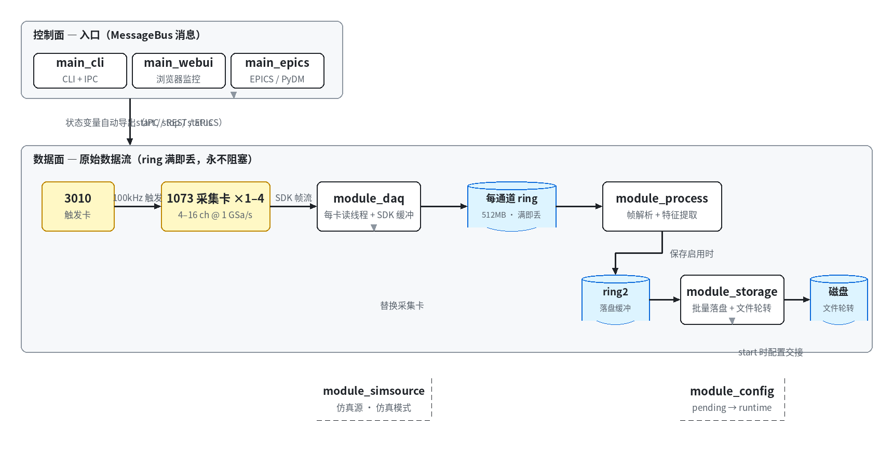
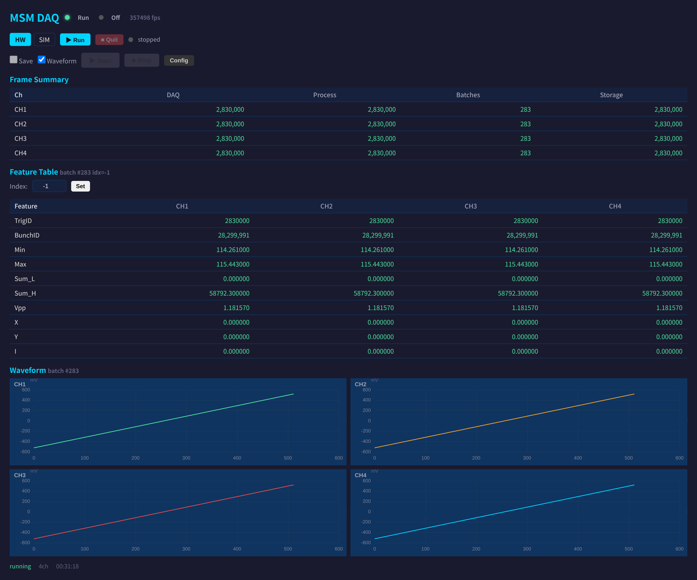

# MSM — Message-based State Machine

**基于消息的状态机框架。为 AI 编码而设计：用结构解决注意力不够的问题。** 模块即上下文单元，消息即唯一契约，两者构成**模块间解耦**：模块互不显式依赖，仅以消息契约接入系统。把多个产品和模块串进一个系统，与让 AI 安全参与大代码库，结构要求是同一件：每个参与者（AI 或人）只需看到自己的模块和接口契约，不必把整个系统装进脑子。

## AI 写大规模代码的三个失效

AI 写大规模代码，失效集中在三处——架构逐一用结构回答，不靠纪律：

| 痛点 | 本架构的约束 | 得到的性质 |
|:--|:--|:--|
| 上下文装不下调用链：改动时看不见上下游，容易碰坏看不见的依赖 | 模块即上下文单元：独立线程、消息队列、状态机，编译期与兄弟模块隔离 | **可审查**：改动边界即模块边界 |
| 影响面不可枚举：隐式耦合、共享状态，改一处不知道还会坏哪里 | 消息是唯一的跨模块接口，无共享全局状态 | **可定位**：影响面等于契约面 |
| 正确性只能靠整机验证：每次改动都要整机加硬件，反馈周期长 | 模块可独立实例化、以消息序列驱动，硬件可被仿真源替换 | **可测试**：单个模块即可运行验证 |

三条约束收敛到同一结论：**任一改动的边界 = 一个模块 + 一份消息契约。**

## 约束的落地形态

### 模块自治

每个模块持有独立线程、消息队列与状态机，头文件不引用兄弟模块——编译级解耦。模块边界与编译边界重合，改动的工作集即该模块源码，评审单位即该模块。

### 消息即契约

跨模块只存在 `Message` 一种通信原语，无共享全局状态——运行级解耦。契约面由命令集与变量声明构成，可枚举、可评审、可静态检查；全仓 28 处 `declareVar` 声明即全部对外变量，可用 grep 直接核对。IPC、REST、EPICS 等接口层由变量声明自动导出，不构成额外契约。

### 单模块可验证

模块可脱离系统独立实例化，以消息序列驱动状态迁移；仿真源模块可替换采集硬件，验证不依赖整机与仪器排期。

## 设计渊源：从 CSM 到 MSM

本项目仿写自 **NI CSM（Communicable State Machine）** 架构——基于 JKI State Machine 的开源 LabVIEW 应用框架，**MIT 授权**，架构介绍见 [可通讯状态机（CSM）架构框架优势实例分析](https://zhuanlan.zhihu.com/p/1942689627426264231)。CSM 的命题：文本消息构成"隐形的通讯总线"——模块互不显式依赖，以"挂载"方式加入系统，接口分工由文档而非代码定义；架构师可以脱离代码做设计，测试可以脚本化。CSM 的报告同样列出了"系统架构设计需要提前回答的问题"（实现细节、消息设计、扩展性、复用性、团队分工）——人团队的痛点和 AI 是同一组，答案的形态也一致。

MSM 把这同一套契约搬进 C++，面向 AI 编码场景：CSM 服务的团队是人，MSM 服务的是 AI 智能体与人的协作——前者的注意力有限，后者的注意力更有限。消息语法沿用 CSM 约定（`NIStringParser` 一等公民支持），对 LabVIEW 技术栈无迁移成本。

---

# 实例：高速数据采集（PXIe 1073 + 3010）

上述架构在本实例中经真实硬件验证：PXIe 1073 × 1–4 + 3010 触发卡，多卡同步采集（4–16 通道）、帧解析与特征提取、批量落盘。三个接口入口（CLI / 浏览器 / EPICS）均为后加，以消息契约挂载，既有契约零改动。

### 模块与数据流向

实线为原始数据流：ring 满即丢、丢帧必暴露，永不阻塞。虚线为控制与状态：全部走消息与自动导出的状态变量。

CSM 报告的示例管线与本实例一一对应：

| CSM 报告示例 | 实例模块 |
|:--|:--|
| DAQ | `module_daq` 采集（PXIe 1073 + 3010） |
| Algorithm | `module_process` 帧解析与特征提取 |
| Logging | `module_storage` 批量落盘与文件轮转 |
| 界面（显示/控制） | `main_webui` / `main_epics`（PyDM）/ `main_cli` |

*监控界面：帧计数、特征表、四通道波形实时刷新，数据来自仿真源。*

## 工程构成

框架核心只有一个目录，其余全部是可替换的实例。换一套硬件、换一类业务，核心代码不动。

| 类别 | 目录 | 职责 |
|:--|:--|:--|
| **框架核心** | `module_core/` | 唯一的框架代码：消息模型与 MessageBus、Module 基类、VarTable，以及 IPC、REST、EPICS 接口层 |
| 实例：业务模块 | `module_daq/` | 采集实例，PXIe 1073 + 3010 硬件控制 |
| | `module_process/` | 帧解析与特征提取（Vpp、X、Y、光强、波形） |
| | `module_storage/` | 批量落盘与文件轮转 |
| | `module_config/` | 配置实例，负责 pending 到 runtime 的交接 |
| | `module_simsource/` | 仿真数据源，替代采集卡 |
| 实例：启动入口 | `main_cli/` | CLI 入口，内建 IPC server |
| | `main_webui/` | 浏览器监控入口，IPC 转 HTTP 与 SSE，ECharts 绘图 |
| | `main_epics/` | EPICS CA 桥与 PyDM 控制界面 |
| 实例：配置与依赖 | `config/` | 共享配置，`pv_map.json` 是 PV 的唯一真源 |
| | `sdk_include/` | 硬件 SDK 头文件 |
| 文档 | `docs/`、`tasks/` | 设计文档与可追溯的任务流水 |

`module_datachannel/`、`main_config_editor/`、`tools/` 同样是实例，按需取用。

## 用法

构建：`cmake -B build && cmake --build build -j`

| 入口 | 用途 |
|:--|:--|
| `./main_cli/build/msm_cli_simsrc` | 仿真采集，1–4 卡 / 4–16 通道，不依赖硬件 |
| `./main_cli/build/msm_cli_hwdaq` | 真实硬件，1 GSa/s |
| `./main_webui/build/msm_webui` | 浏览器端波形与状态监控 |
| `./main_epics/run_epics.sh` | 启动 IOC 与 CA 桥 |
| `./main_epics/run_pydm.sh` | 启动 PyDM 控制界面 |

CLI 命令：`start`、`stop`、`enablesave`、`disablesave`、`status`、`quit`。

配置变更写入 `config/app_pending_config.json`，于下一次 `start` 时由后端完成 pending 到 runtime 的交接并重配硬件，无需 reload。

新增模块即"挂载"：继承 `Module`，实现 `handleState()`，以 `declareVar()` 声明对外变量。声明即导出，IPC、REST、EPICS 三个入口自动可访问；既有模块不必知晓，更不必改动。

## 设计文档

| 文档 | 内容 |
|:--|:--|
| `docs/arch/design.md` | 框架设计：消息模型、MessageBus、接口层 |
| `tasks/` | 32 份决策与实测记录 |
| `docs/arch/MSMvsEPICS.md` | 与 EPICS、Bluesky 的架构对比 |

---

当前为单机部署，多机调度与硬实时指标未覆盖。

联系：zhengjituo@gmail.com

  

